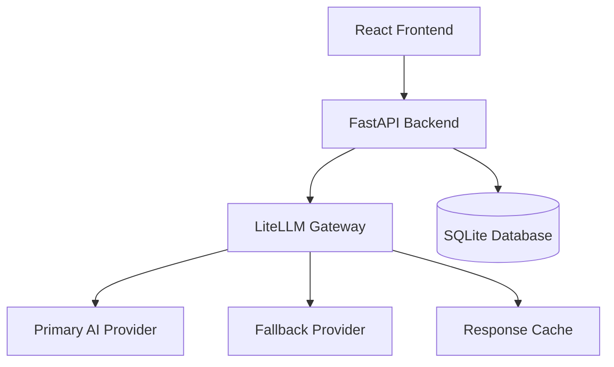

# Lyftr AI — Full-Stack AI Chatbot

<p align="center">
  <strong>A resilient full-stack AI chatbot powered by LiteLLM, with automatic provider failover, response caching, and persistent conversations.</strong>
</p>

<p align="center">
  <a href="https://aichatbot00.netlify.app">🌐 Live Application</a> •
  <a href="https://ai-chatbot-xgce.onrender.com/health">💚 Backend Health</a> •
  <a href="https://ai-chatbot-xgce.onrender.com/docs">📚 API Documentation</a> •
  <a href="https://github.com/IshaVishwas/AI-ChatBot">💻 GitHub Repository</a>
</p>

---

## Overview

Lyftr AI is a full-stack AI chatbot built to demonstrate how an AI-powered application can be designed for reliability, performance, and persistent conversation management.

The application integrates a React frontend with a FastAPI backend, using LiteLLM as the AI gateway for model interaction, response caching, and automatic provider/key failover. Conversations are stored in SQLite, allowing session-based chat history to persist independently of frontend state.

Rather than relying on a single successful AI request, the system incorporates mechanisms to handle provider failures, reuse cached responses, track request-level metrics, and maintain conversation context.

## 🔗 Live Deployment

| Component | Deployment | Link |
|---|---|---|
| Frontend | Netlify | [https://aichatbot00.netlify.app](https://aichatbot00.netlify.app) |
| Backend | Render | [https://ai-chatbot-xgce.onrender.com](https://ai-chatbot-xgce.onrender.com) |
| Health Endpoint | Render | [https://ai-chatbot-xgce.onrender.com/health](https://ai-chatbot-xgce.onrender.com/health) |
| API Documentation | FastAPI Swagger UI | [https://ai-chatbot-xgce.onrender.com/docs](https://ai-chatbot-xgce.onrender.com/docs) |


## Features

### AI Chat Interface
- Interactive chat interface built with React.
- Multi-turn conversational interaction.
- Session-based conversations.
- Markdown-compatible AI responses.
- Clear handling of API errors.

### AI Gateway & Provider Failover
- LiteLLM integration for AI model communication.
- Configurable provider/key pool.
- Automatic fallback when a provider encounters rate limits, quota errors, or server failures.
- Failure simulation through the `X-Simulate-Failure` header.
- Graceful handling when configured providers are unavailable.

### Response Caching
- LiteLLM-based response caching.
- Identifies cached and live responses using:
  - `LLM_CACHE`
  - `LIVE_INFERENCE`
- Reuses matching responses to reduce repeated model calls.
- Displays response metadata for cache verification.

### Conversation Persistence
- SQLite-based message storage.
- Session-specific message history.
- Persistent conversations across page refreshes.
- Backend-managed conversation context.
- Dedicated endpoint for retrieving session messages.

### Request-Level Observability

Each AI response displays request-specific metadata:

| Metric | Description |
|---|---|
| Resolution Source | Indicates cached response or live inference |
| Model | Model that generated the response |
| Latency | Server-measured response time in milliseconds |
| Input Tokens | Input token usage for the request |
| Output Tokens | Output token usage for the response |

### Backend API
- RESTful API built using FastAPI.
- Request validation using Pydantic.
- Health monitoring endpoint.
- Session history endpoint.
- Structured JSON error responses.

---

## Architecture



### Request Flow

1. The user sends a message through the React frontend.
2. The frontend sends the request to the FastAPI backend with the session ID.
3. The backend retrieves the relevant conversation history from SQLite.
4. The request is forwarded through LiteLLM.
5. LiteLLM resolves the request through the cache or live model inference.
6. If a configured provider fails, the gateway attempts the next available provider.
7. The response and request metadata are returned to the frontend.
8. The conversation is persisted in SQLite.

---

## Tech Stack

| Layer | Technologies |
|---|---|
| Frontend | React, JavaScript, Vite |
| Backend | Python, FastAPI |
| AI Gateway | LiteLLM |
| AI Providers | Gemini, OpenRouter |
| Database | SQLite |
| Containerization | Docker, Docker Compose |
| Backend Testing | Pytest |
| Frontend Deployment | Netlify |
| Backend Deployment | Render |
| Version Control | Git, GitHub |

---

## Project Structure

```text
AI-ChatBot/
│
├── backend/
│   ├── app/
│   │   ├── routers/
│   │   │   ├── chat.py
│   │   │   ├── health.py
│   │   │   └── sessions.py
│   │   │
│   │   ├── services/
│   │   │   └── llm_service.py
│   │   │
│   │   ├── config.py
│   │   ├── database.py
│   │   ├── models.py
│   │   ├── schemas.py
│   │   └── main.py
│   │
│   ├── tests/
│   │   ├── test_cache.py
│   │   ├── test_chat_and_memory.py
│   │   ├── test_failover.py
│   │   ├── test_health.py
│   │   └── test_validation.py
│   │
│   ├── Dockerfile
│   └── requirements.txt
│
├── frontend/
│   ├── public/
│   ├── src/
│   │   ├── components/
│   │   ├── assets/
│   │   ├── App.jsx
│   │   ├── App.css
│   │   └── index.css
│   │
│   ├── Dockerfile
│   ├── package.json
│   └── vite.config.js
│
├── docker-compose.yml
├── Makefile
├── .env.example
├── .gitignore
└── README.md
```

---

## API Endpoints

| Method | Endpoint | Description |
|---|---|---|
| GET | `/health` | Checks backend and configuration health |
| POST | `/chat` | Sends a message and generates an AI response |
| GET | `/sessions/{session_id}/messages` | Retrieves stored conversation history |

### Chat Request

```json
{
  "session_id": "session-123",
  "message": "Explain caching in AI applications."
}
```

### Response

```json
{
  "session_id": "session-123",
  "reply": "Caching allows applications to reuse previously generated responses...",
  "metadata": {
    "resolution_source": "LIVE_INFERENCE",
    "model": "model-name",
    "latency_ms": 850,
    "input_tokens": 25,
    "output_tokens": 60,
    "key_id": "key_1",
    "fallback_attempts": 0
  }
}
```

> Response values above are illustrative.

---

## Design Decisions

### 1. LiteLLM as the AI Gateway

LiteLLM provides a unified interface for interacting with AI providers. It allows the application to integrate provider configurations, caching, and failover mechanisms without tightly coupling the backend to a single provider.

### 2. Automatic Provider Failover

The application is configured with multiple provider/key options. When the primary configured key encounters a supported failure, the system attempts another configured key.

A failure simulation mechanism allows failover to be tested without deliberately exhausting API quotas.

### 3. SQLite for Persistence

SQLite was selected for lightweight, reliable session storage without requiring an additional database service.

Conversation messages are associated with session IDs, allowing the backend to reconstruct conversation context for subsequent requests.

### 4. Request-Level Metadata

Request-level token usage, latency, model information, and resolution source are returned with each response.

This provides transparency into the AI request lifecycle and makes it easier to verify caching and model execution.

---

## Running Locally

### Prerequisites

- Python 3.10+
- Node.js and npm
- Docker and Docker Compose (for containerized execution)
- API keys for the configured AI providers

### 1. Clone the Repository

```bash
git clone https://github.com/IshaVishwas/AI-ChatBot.git
cd AI-ChatBot
```

### 2. Configure Environment Variables

Create environment files using the provided examples.

```bash
cp .env.example .env
```

Configure the backend environment variables and provider credentials.

> Never commit actual API keys or secrets.

### 3. Run Using Docker

From the project root:

```bash
make up
```

Expected local endpoints:

| Service | URL |
|---|---|
| Frontend | http://localhost:3000 |
| Backend | http://localhost:8000 |
| API Documentation | http://localhost:8000/docs |

To stop the services:

```bash
make down
```

### 4. Run Without Docker

#### Backend

```bash
cd backend
python -m venv .venv
```

Activate the environment:

**Windows:**

```powershell
.venv\Scripts\Activate.ps1
```

Install dependencies:

```bash
pip install -r requirements.txt
```

Run the backend:

```bash
python -m uvicorn app.main:app --reload
```

Backend:

```text
http://localhost:8000
```

#### Frontend

Open another terminal:

```bash
cd frontend
npm install
npm run dev
```

The frontend development server will provide its local URL.

---

## Verification

### 1. Verify Backend Health

```bash
curl http://localhost:8000/health
```

### 2. Verify Live Inference

Send a message through the chat interface and inspect the response metadata.

Expected resolution source:

```text
LIVE_INFERENCE
```

### 3. Verify Caching

Repeat the same initial prompt in a new session.

Expected resolution source on a cache hit:

```text
LLM_CACHE
```

### 4. Verify Provider Failover

Send a request with the following header:

```text
X-Simulate-Failure: key_1=429
```

The backend should simulate a rate-limit failure for the first configured key and attempt the next key.

### 5. Verify Session History

Retrieve session messages using:

```text
GET /sessions/{session_id}/messages
```

### 6. Run Backend Tests

From the backend directory:

```bash
pytest
```

---

## Security

- API keys are stored in environment variables.
- Secret credentials are excluded from version control.
- Provider key identifiers are returned instead of actual API keys.
- Configuration is managed through environment variables.

---

## Setup Used

- **Editor:** Visual Studio Code
- **AI-assisted development:** AI coding assistants and technical documentation were used during development and debugging.
- **Version Control:** Git and GitHub

---

## Future Improvements

- Authentication and user-specific chat sessions.
- Streaming AI responses.
- Improved rate-limit handling and retry policies.
- More advanced session management.
- Expanded monitoring and logging.
- Additional automated integration tests.

---

## Author

**Isha**

Final-year B.Tech Computer Science student specializing in Artificial Intelligence and Machine Learning.

---

<p align="center">
  Built with React, FastAPI, LiteLLM, and SQLite.
</p>
